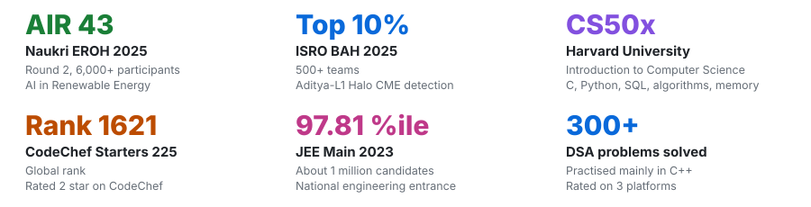
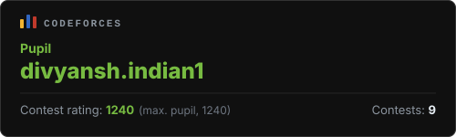

&nbsp;

&nbsp;

&nbsp;

  

 

<a href="#about">About</a> &nbsp;/&nbsp;
<a href="#experience">Experience</a> &nbsp;/&nbsp;
<a href="#featured-projects">Projects</a> &nbsp;/&nbsp;
<a href="#tech-stack">Stack</a> &nbsp;/&nbsp;
<a href="#achievements">Achievements</a> &nbsp;/&nbsp;
<a href="#coding-profiles">Profiles</a> &nbsp;/&nbsp;
<a href="#github-stats">Stats</a> &nbsp;/&nbsp;
<a href="#contact">Contact</a>

<!-- ================================ ABOUT ================================= -->

 

 

<!-- =============================== EXPERIENCE ============================== -->

 

 

**Information Warfare Intern** &nbsp;·&nbsp; Indian Army Southern Command &nbsp;·&nbsp; *Aug 2026 – Oct 2026*

- Automated data collection and analysis workflows using open-source intelligence tools
- Applied Generative AI tools and chatbots to reduce repetitive analytical tasks
- Built a cross-platform approach to detect coordinated bot activity and potential fake news through content analysis

 

**B.Tech in Computer Science and Engineering** &nbsp;·&nbsp; IIIT Pune &nbsp;·&nbsp; *2023 – 2027*

<!-- ========================== FEATURED PROJECTS =========================== -->

 

 

<table width="100%" cellpadding="12">
<tr>

<td width="50%" valign="top">
<h3><a href="https://github.com/inddivyansh/CruxGPT_v2">CruxGPT v2</a> &nbsp;·&nbsp; <a href="https://cruxgpt.vercel.app/">Demo</a></h3>
<b>AI document intelligence platform</b>
<ul>
<li>Natural-language Q&amp;A over long documents (policies, compliance) with source citation inspection</li>
<li>FastAPI backend with 8 modular API domains: auth, documents, chat, admin</li>
<li>RAG pipeline on Google Gemini with candidate scoring, caching, and an 8-message context window</li>
<li>Multi-tenant user isolation in PostgreSQL with full audit trails</li>
</ul>
 

</td>

<td width="50%" valign="top">
<h3><a href="https://github.com/inddivyansh/BuildWiseAI_v2">BuildWiseAI v2</a></h3>
<b>Generative blueprint studio &amp; code compliance</b>
<ul>
<li>Turns written design briefs into vector floor plans, editable in an interactive 2D canvas and real-time 3D viewer</li>
<li>Deterministic compliance engine: pure-Python geometric rules check drawings against code clauses with no LLM guesswork</li>
<li>Citations recorded in a Neo4j knowledge graph; one-click handoff from design to audit</li>
<li>Exports to IFC, DXF, PDF, SVG, and GeoJSON</li>
</ul>
 

&nbsp;

</td>

</tr>
<tr>

<td width="50%" valign="top">
<h3><a href="https://github.com/inddivyansh/NEUROWALL">NeuroWall</a></h3>
<b>AI-powered web application firewall</b>
<ul>
<li>Real-time request inspection with 0.05 s average latency</li>
<li>Hybrid engine: rule-based + Transformers + Autoencoders — 94.5% detection accuracy vs. 78% baseline</li>
<li>Mitigates SQLi, XSS, and RCE with a 92% block rate and 2% false positives</li>
<li>Dockerized microservices with a React monitoring dashboard</li>
</ul>
 

</td>

<td width="50%" valign="top">
<h3><a href="https://github.com/inddivyansh/ISRO-BAH">Aditya-L1 Halo CME Detection</a></h3>
<b>Satellite time-series ML &nbsp;·&nbsp; ISRO BAH 2025</b>
<ul>
<li>Detects particle signatures of Halo Coronal Mass Ejections in noisy Aditya-L1 telemetry</li>
<li>Rolling variability indicators, dynamic-pressure features, chronological splits, and SMOTE</li>
<li>Tuned XGBoost, Random Forest, and Gradient Boosting: ROC-AUC &gt; 0.87 and 24% fewer false positives</li>
</ul>
 

&nbsp;

&nbsp;

&nbsp;

</td>

</tr>
<tr>

<td width="50%" valign="top">
<h3><a href="https://github.com/inddivyansh/MusicLens">MusicLens</a></h3>
<b>Spotify track analytics &amp; recommendation</b>
<ul>
<li>Python pipeline cleans a 30,000-song catalog, loads a PostgreSQL warehouse, and exports compact JSON</li>
<li>React + Vite dashboard for genre, popularity, and audio-feature analytics</li>
<li>Explainable content-based recommendations that run directly in the browser; deployed on Vercel</li>
</ul>
 

&nbsp;

&nbsp;

</td>

<td width="50%" valign="top">
<h3><a href="https://github.com/inddivyansh/MarginLeak">MarginLeak</a></h3>
<b>Autonomous accounts-payable auditor</b>
<ul>
<li>Spots invoice anomalies for small businesses: price creep, duplicate charges, quantity mismatches, PO discrepancies</li>
<li>LLM-assisted analysis behind a FastAPI service with a React front end</li>
<li>Automated reconciliation and audit trail export</li>
</ul>
 

</td>

</tr>
</table>

 

<!-- =============================== TECH STACK ============================== -->

 

 

**Languages**

 

**Frameworks &amp; Backend**

 

**Machine Learning &amp; Data**

&nbsp;

&nbsp;

&nbsp;

 

**Databases &amp; Storage**

&nbsp;

 

**DevOps &amp; Tools**

 

**Cloud &amp; Deployment**

 

&nbsp;

&nbsp;

<!-- ============================== ACHIEVEMENTS ============================= -->

 

 

 

<b>Certifications</b>

 

| Certification | Issuer |
|:---|:---|
| CS50x — Introduction to Computer Science | Harvard University |
| AWS Cloud Essentials | Amazon Web Services |
| Google Cloud Essentials | Google |
| Google Cloud Arcade 2025 | Google |
| Introduction to Cybersecurity | Cisco |

<!-- ============================ CODING PROFILES ============================ -->

 

 

<table align="center" border="0" cellpadding="0" cellspacing="0">
<tr valign="middle">
<td width="50%" align="center" valign="middle">
  
    
  
</td>
<td width="50%" align="center" valign="middle">
  
</td>
</tr>
</table>

<!-- =============================== GITHUB STATS ============================ -->

 

 

<table align="center" border="0" cellpadding="6">
<tr>
<td valign="middle" align="center">

</td>
<td valign="middle" align="center">

</td>
<td valign="middle" align="center">

</td>
</tr>
</table>

<!-- ============================ CONTRIBUTION SNAKE ========================== -->

 

 

<!-- ================================= CONTACT =============================== -->

 

 

I'm open to **internships and full-time opportunities**, and always happy to connect with people building useful things with AI, data, and software.

  

&nbsp;

&nbsp;

 

<!--
Maintenance:
- Refresh all SVG assets : python tools/generate_assets.py
- Refresh snake only     : python tools/generate_snake.py
  (also runs automatically twice daily via .github/workflows/snake.yml)
-->
