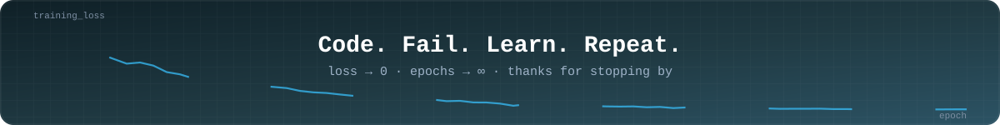

<div align="center">


<br/>

<a href="https://diivyportfolio.vercel.app/"></a>
<a href="https://www.linkedin.com/in/diivyaix/"></a>
<a href="mailto:divyansh.indian1@gmail.com"></a>


<br/><br/>

<sub>
<a href="#coding-profiles">Coding Profiles</a> /
<a href="#highlights">Highlights</a> /
<a href="#about">About</a> /
<a href="#featured-projects">Projects</a> /
<a href="#tech-stack">Stack</a> /
<a href="#experience">Experience</a> /
<a href="#github-stats">Stats</a> /
<a href="#contact">Contact</a>
</sub>

</div>

<br/>

<!-- ============================ CODING PROFILES ============================ -->
<h2 id="coding-profiles" align="center"></h2>

<div align="center">

<a href="https://www.codechef.com/users/divyanshindian"></a>
<a href="https://codeforces.com/profile/divyansh.indian1"></a>
<a href="https://leetcode.com/u/inddivyansh/"></a>


<br/><br/>

<a href="https://leetcode.com/u/inddivyansh/"></a>

<br/><br/>

| Platform | Handle | Current Standing |
|:--|:--|:--|
| CodeChef | [`divyanshindian`](https://www.codechef.com/users/divyanshindian) | 1570, 2 Star &nbsp;(Global Rank 1621 in Starters 225) |
| Codeforces | [`divyansh.indian1`](https://codeforces.com/profile/divyansh.indian1) | 1240, Pupil |
| LeetCode | [`inddivyansh`](https://leetcode.com/u/inddivyansh/) | 1573, Top 28% |

</div>

<!-- ============================== HIGHLIGHTS ============================== -->
<h2 id="highlights" align="center"></h2>

<div align="center">






</div>

<!-- ================================ ABOUT ================================= -->
<h2 id="about" align="center"></h2>

```python
class Divyansh:
    education = "B.Tech CSE, IIIT Pune (2023 - 2027)"
    focus     = ["Generative AI and RAG", "Backend and APIs", "ML on time-series data", "AI security"]
    languages = ["C++", "Python", "SQL", "Java (basics)"]
    now       = "Shipping AI products and sharpening DSA in C++"
    open_to   = ["Internships", "Hackathons", "Research", "Collaboration"]

    def motto(self):
        return "Code. Fail. Learn. Repeat. Success is just a loop away."
```

I'm a final-year Computer Science student at **IIIT Pune** who likes turning machine learning and backend engineering into working products: document-intelligence platforms, real-time security tooling and satellite data pipelines.

- 🤖 **AI engineering:** RAG, LLM integrations, document intelligence, model evaluation, applied ML
- 🛠️ **Full-stack:** React interfaces and Python APIs with databases, auth and deployable workflows
- 📊 **Data & ML:** feature engineering, time-series analysis, classification, evaluation on real datasets
- 🧩 **Problem solving:** 300+ DSA problems solved, sharpening C++ and algorithmic thinking
- 🤝 **Open to:** internships, hackathons, research and open-source collaboration

<!-- ========================== FEATURED PROJECTS =========================== -->
<h2 id="featured-projects" align="center"></h2>

<table>
<tr>
<td width="50%" valign="top">
<h3>📚 <a href="https://github.com/inddivyansh/CruxGPT_v2">CruxGPT</a> &nbsp;·&nbsp; <a href="https://cruxgpt.vercel.app/">Live demo</a></h3>
<b>AI document intelligence platform</b>
<ul>
<li>Natural-language Q&amp;A over long documents (policies, compliance) with source inspection</li>
<li>FastAPI backend with 8 modular API domains: auth, documents, chat, admin</li>
<li>RAG pipeline on Google Gemini with candidate scoring, caching and an 8-message context window</li>
<li>Multi-tenant user isolation in PostgreSQL with audit trails</li>
</ul>

</td>
<td width="50%" valign="top">
<h3>🛡️ <a href="https://github.com/inddivyansh/NEUROWALL">NeuroWall</a></h3>
<b>AI-powered web application firewall</b>
<ul>
<li>Real-time request inspection with 0.05s average latency</li>
<li>Hybrid engine: rules plus Transformers and Autoencoders, 94.5% detection accuracy (vs. 78% baseline)</li>
<li>Mitigates SQLi, XSS and RCE with a 92% block rate and 2% false positives</li>
<li>Dockerized microservices with a React monitoring dashboard</li>
</ul>

</td>
</tr>
<tr>
<td width="50%" valign="top">
<h3>🛰️ <a href="https://github.com/inddivyansh/ISRO-BAH">Aditya-L1 Halo CME Detection</a></h3>
<b>Satellite time-series ML &nbsp;·&nbsp; ISRO BAH 2025</b>
<ul>
<li>Detects particle signatures of Halo Coronal Mass Ejections in noisy Aditya-L1 telemetry</li>
<li>Rolling variability indicators, dynamic-pressure features, chronological splits and SMOTE</li>
<li>Tuned XGBoost, Random Forest and Gradient Boosting: ROC-AUC above 0.87 and 24% fewer false positives</li>
</ul>

</td>
<td width="50%" valign="top">
<h3>🧾 <a href="https://github.com/inddivyansh/MarginLeak">MarginLeak</a></h3>
<b>Autonomous accounts-payable auditor</b>
<ul>
<li>Spots invoice anomalies for small businesses: price creep, duplicate charges, quantity mismatches, PO discrepancies</li>
<li>LLM-assisted analysis behind a FastAPI service with a React front end</li>
</ul>

</td>
</tr>
<tr>
<td width="50%" valign="top">
<h3>🏗️ <a href="https://github.com/inddivyansh/BuildWiseAI">BuildWiseAI</a></h3>
<b>AI-assisted construction-plan intelligence</b>
<ul>
<li>Document and plan understanding workflows that make construction information easier to analyze and validate</li>
<li>Vector search over plan content, served through FastAPI</li>
</ul>

</td>
<td width="50%" valign="top">
<h3>🎧 <a href="https://github.com/inddivyansh/MusicLens">MusicLens</a></h3>
<b>Spotify track analytics &amp; recommendation</b>
<ul>
<li>Exploratory analysis of track metadata and audio features</li>
<li>Content-based recommendations with a React + Vite front end</li>
</ul>

</td>
</tr>
</table>

<p align="center">
<a href="https://github.com/inddivyansh?tab=repositories"></a>
</p>

<!-- =============================== TECH STACK ============================== -->
<h2 id="tech-stack" align="center"></h2>

<div align="center">

<br/>

<br/>

<br/>

<br/>

<br/><br/>


</div>

<!-- ================================ EXPERIENCE ============================= -->
<h2 id="experience" align="center"></h2>

**Information Warfare Intern, Indian Army Southern Command** &nbsp;/&nbsp; *Aug 2026 - Oct 2026*

- Automated data collection and analysis workflows using open-source tools
- Applied Generative AI tools and chatbots to reduce repetitive work
- Built a cross-platform approach to identify coordinated bots and potential fake news through content analysis

**Certifications:** CS50x (Harvard University) / AWS Cloud Essentials / Google Cloud Essentials / Google Cloud Arcade 2025 / Cisco Introduction to Cybersecurity

<!-- =============================== GITHUB STATS ============================ -->
<h2 id="github-stats" align="center"></h2>

<div align="center">


<br/>

</div>

<!-- ================================= CONTACT =============================== -->
<h2 id="contact" align="center"></h2>

<div align="center">

I'm always happy to meet people building useful things with AI, data and software.

<a href="mailto:divyansh.indian1@gmail.com"></a>
<a href="https://www.linkedin.com/in/diivyaix/"></a>
<a href="https://diivyportfolio.vercel.app/"></a>

</div>

<!-- ============================ CONTRIBUTION SNAKE ========================== -->
<h2 id="contribution-snake" align="center"></h2>

<div align="center">
<picture>
  <source media="(prefers-color-scheme: dark)" srcset="https://raw.githubusercontent.com/inddivyansh/inddivyansh/output/github-snake-dark.svg"/>
  <source media="(prefers-color-scheme: light)" srcset="https://raw.githubusercontent.com/inddivyansh/inddivyansh/output/github-snake.svg"/>
  
</picture>
</div>

<br/>

<!-- ================================= FOOTER ================================ -->


<!--
Maintenance
- Edit ratings/numbers in tools/generate_assets.py (PROFILE_CARDS / HIGHLIGHT_CARDS), run `python tools/generate_assets.py`, commit assets/.
- Profile README repo name must exactly match your username: inddivyansh/inddivyansh.
- Snake: Actions tab -> "Generate contribution snake" -> Run workflow (first time only). It writes to the `output` branch.
-->
